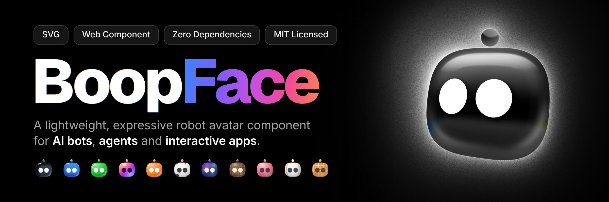

# BoopFace

<p align="center">
  
</p>

**공식 웹사이트: [boopface.com](https://boopface.com/)**

[English](https://github.com/CX-ArtLab/boopface/blob/main/README.md) | [简体中文](https://github.com/CX-ArtLab/boopface/blob/main/docs/README.zh-CN.md) | [Español](https://github.com/CX-ArtLab/boopface/blob/main/docs/README.es.md) | [Русский](https://github.com/CX-ArtLab/boopface/blob/main/docs/README.ru.md) | [Français](https://github.com/CX-ArtLab/boopface/blob/main/docs/README.fr.md) | [Português](https://github.com/CX-ArtLab/boopface/blob/main/docs/README.pt.md) | [Deutsch](https://github.com/CX-ArtLab/boopface/blob/main/docs/README.de.md) | [日本語](https://github.com/CX-ArtLab/boopface/blob/main/docs/README.ja.md) | [한국어](https://github.com/CX-ArtLab/boopface/blob/main/docs/README.ko.md) | [繁體中文](https://github.com/CX-ArtLab/boopface/blob/main/docs/README.zh-TW.md)

 [](../LICENSE) [](https://github.com/CX-ArtLab/boopface/actions/workflows/validate.yml) [](https://ko-fi.com/P0E625WIOI)

    

BoopFace는 AI 봇, 에이전트, 인터랙티브 앱을 위한 가볍고 표현력 있는 로봇 아바타 컴포넌트입니다. 생각 중, 대기 중, 완료, 오류까지 에이전트의 모든 상태를 표정으로 보여 줄 수 있습니다.

AI 어시스턴트와 에이전트의 얼굴이자 상태 피드백으로 쓸 수 있습니다. ChatGPT, Claude, Gemini, Grok, DeepSeek 같은 채팅 어시스턴트, Codex, Claude Code, Cursor, Gemini CLI, OpenCode 같은 코딩 에이전트, 그리고 Grok Bot, ChatGPT dots, Meta Muse, OpenClaw, Hermes Agent 같은 상주형 에이전트에 어울립니다.

데스크톱 컴패니언, 가상 펫, 디지털 마스코트, 챗봇 아바타 같은 인터랙티브 캐릭터에도, AG-UI 스타일 에이전트 인터페이스의 시각 피드백 레이어로도 쓸 수 있습니다.

SVG와 순수 JavaScript로 만든 네이티브 Web Component로, 런타임 의존성이 없고 MIT 라이선스입니다. 188가지 [스킨](#스킨--07-새-기능)을 언제든지 입힐 수 있습니다.

<p align="center">
  
</p>

## 새 지원: [BoopFace Embedded](#boopface-embedded)

<p align="center">
  <a href="#boopface-embedded"></a>
</p>

ESP32, STM32, Raspberry Pi Pico 화면과 다른 C++ 프로그램에서 같은 눈 표정을 사용합니다. 28가지 구성의 예제 펌웨어와 설정을 내보내는 시뮬레이터를 제공합니다.

## 라이브 데모

[인터랙티브 데모 열기](https://cx-artlab.github.io/BoopFace/?lang=ko) · [스킨 갤러리 둘러보기](https://cx-artlab.github.io/BoopFace/skins.html?lang=ko) · [AI 연결 데모](https://cx-artlab.github.io/BoopFace/agent.html?lang=ko)

[임베디드 시뮬레이터 열기](https://cx-artlab.github.io/BoopFace/hardware/?lang=ko)

## 주요 특징

- 네이티브 Web Component
- SVG 렌더링 + 순수 JavaScript
- 런타임 의존성 0
- 자동 눈 깜빡임과 은은한 idle 동작
- 포인터를 따라가는 눈과 관성 있는 머리 움직임
- 젤리 스타일의 국소 드래그 변형과 탄성 복귀
- 길게 누르는 압축과 드래그 가능한 스프링 안테나
- 프로그램으로 제어할 수 있는 Agent 상태와 표정
- waiting, success, failure, affirm, wary, inspect, angry, refuse, love 등의 표정
- Reduced Motion 지원
- 설정 가능한 수면 동작
- 조절 가능한 머리 둥글기
- 17개 시리즈, 188가지 번호 스킨. 빛이 포인터를 따라갑니다
- 스킨을 뺀 경량판 제공
- `connectAgent()`: AI 스트림 이벤트로 표정을 자동 전환 (AG-UI, OpenAI, Anthropic, Vercel AI SDK)
- 음성 대화: 실제 음량을 따라 움직이는 듣기·말하기 표정
- TypeScript 선언 포함

## 설치

```bash
npm install boopface
```

```js
import 'boopface';
```

또는 [최신 릴리스](https://github.com/CX-ArtLab/boopface/releases/latest)에서 `boopface-x.y.z.zip`을 내려받으세요. 컴포넌트만 들어 있으며 스킨도 포함됩니다. 페이지 옆에 압축을 풀어 주세요.

```html
<script type="module" src="./boopface/boopface.js"></script>
```

그다음 컴포넌트를 추가합니다.

```html
<boop-face id="avatar"></boop-face>
```

별도의 초기화 코드는 필요하지 않습니다. 아바타는 자동으로 기본 idle 상태로 들어갑니다.

### Agent Robot Avatar에서 업그레이드하기

BoopFace의 0.8 이전 이름은 Agent Robot Avatar입니다. 기능과 사용법은 그대로입니다. 패키지 이름만 `boopface`로 바꾸면 업그레이드됩니다:

```bash
npm uninstall agent-robot-avatar
npm install boopface
```

예전 태그 `<agent-robot-avatar>`는 1.0까지 계속 쓸 수 있으니 페이지를 서둘러 고칠 필요는 없습니다. 예전 npm 패키지 `agent-robot-avatar`는 더 이상 업데이트되지 않으며, 새 버전은 `boopface`로만 배포됩니다.

### 경량판

스킨을 쓰지 않는 페이지라면 `boopface/lite`를 쓸 수 있습니다. 아바타와 모든 표정은 같고 스킨 코드만 빠져 있습니다:

```js
import 'boopface/lite';
```

경량판은 `skin` 속성을 무시하고, 스킨에는 전체판이 필요하다고 콘솔에 알려 줍니다.

크기 비교(네트워크 전송량, gzip 압축 기준):

| 버전 | 크기 |
| --- | --- |
| 경량판 `boopface/lite` | 약 45KB |
| 전체판, 페이지에서 스킨을 쓰지 않을 때 | 약 56KB, 스킨을 그리는 코드는 다운로드되지 않음 |
| 전체판, 스킨을 쓸 때 | 약 113KB, 늘어난 부분은 스킨을 처음 쓸 때 다운로드됨 |

## 기본 사용법

```js
const avatar = document.querySelector('#avatar');

avatar.play('success');
avatar.play('wary');
avatar.play('refuse');

avatar.reset();
```

사용 가능한 액션:

| 동작 | 모습 | 사용 상황 |
| --- | --- | --- |
| `idle` | 눈을 깜박이며 주변을 둘러봄 | 기본 상태 |
| `bored` | 천천히 양옆을 둘러봄 | 한동안 아무 일도 없을 때 |
| `waiting-spin` | 두 눈이 좌우로 회전 | 응답 대기 (기본) |
| `waiting-wrap` | 두 눈이 한쪽으로 나갔다 반대쪽으로 돌아옴 | 응답 대기 |
| `waiting-wave` | 두 눈이 번갈아 위아래로 출렁임 | 응답 대기 |
| `input` | 두 눈이 깜박이는 입력 커서가 됨 | 사용자가 입력 중 |
| `listening` | 몸을 살짝 기울이고, 사용자 목소리에 따라 눈이 커짐 | 음성 대화: 사용자가 말하는 중 |
| `speaking` | 말하는 리듬에 맞춰 눈이 통통 튐 | 음성 대화: AI가 답하는 중 |
| `affirm` | 고개를 끄덕임 | 확인, 알겠음 |
| `success` | 기쁘게 웃는 눈 | 작업 완료 |
| `failure` | 고개와 눈이 처짐 | 작업 또는 연결 실패 |
| `wary` | 고개를 돌려 경계하며 위아래로 훑어봄 | 사용자 확인이 필요한 작업 |
| `inspect` | 눈을 가늘게 뜨고 위아래로 살핌 | 내용 확인·검토 |
| `angry` | 눈을 내리깔고 노려봄 | 콘텐츠가 차단됨 |
| `refuse` | 고개를 저음 | 할 수 없거나 하지 않을 요청 |
| `surprise` | 눈을 크게 뜸 | 예상 밖의 일 |
| `love` | 두 눈이 뛰는 하트로 합쳐짐 | 감사, 애정 |
| `random` | 두 눈이 슬롯머신 릴처럼 돌아감 | 무작위 선택, 장난스러운 순간 |
| `sleep` | 눈을 감고 잠듦 | 오랫동안 조작이 없을 때 |
| `wake` | 눈을 뜨고 깨어남 | 활동이 다시 시작될 때 |

대기 동작은 `play()`로 한 번 재생됩니다. `startWaiting({ variant: 'spin' | 'wrap' | 'wave' })`는 다른 동작을 재생하거나 `stopWaiting()`을 호출할 때까지 반복됩니다.

0.5의 이전 이름(`send`, `warning`, `error`, `blocked`, `slot` 등)은 1.0 전까지 계속 동작하지만 콘솔에 이름 변경 안내가 표시됩니다. [업그레이드 표](../CHANGELOG.md#upgrading-from-05x)를 참고하세요.

일반적인 Agent 요청 흐름:

```js
avatar.startWaiting();

// 두 번째 대기 동작: 눈이 한쪽으로 빠져나갔다가 반대쪽에서 돌아옵니다.
avatar.startWaiting({ variant: 'wrap' });

// 세 번째 대기 모션: 엇갈려 위아래로 움직이는 눈의 물결.
avatar.startWaiting({ variant: 'wave' });

try {
  const result = await runAgentRequest();
  await avatar.play(result.ok ? 'success' : 'failure');
} catch (error) {
  await avatar.play('failure');
}
```

## 자주 쓰는 옵션

```html
<boop-face
  size="160"
  color="#08090b"
  auto-sleep="30000"
  wake-on="activity"
  motion="auto">
</boop-face>
```

| 속성 | 용도 |
| --- | --- |
| `size` | 아바타 크기(px) |
| `color` | 아바타 기본 색상 |
| `auto-sleep` | 자동 수면까지의 유휴 시간; `0`이면 비활성화 |
| `wake-on` | 자동 깨우기 정책: `activity`, `interaction`, `manual` |
| `motion` | 모션 정책: `auto`, `reduce`, `full` |
| `press-squeeze` | 중앙을 길게 눌러 압축; `false`로 비활성화 |
| `antenna-drag` | 안테나 드래그, 스프링 복귀, 화난 반응; `false`로 비활성화 |
| `skin` | 스킨 번호(예: `301`). 생략하면 단색 |

자주 쓰는 런타임 제어:

```js
avatar.setPointerFollow(false);
avatar.setHeadRoundness(75);
avatar.setPressSqueeze(true);
avatar.setAntennaDrag(true);
```

중앙을 길게 누르면 압축이 시작됩니다. 4 CSS 픽셀을 넘게 움직이면 같은 포인터 제스처가 기존 머리 드래그로 전환됩니다. 안테나는 머리 드래그와 같은 거리 제한을 사용하며 복귀 후 기존 화난 반응이 이어집니다.

## 스킨 · 0.7 새 기능

17개 시리즈, 188가지 스킨이 있으며 빛이 포인터를 따라갑니다. 모든 스킨에는 고정 번호가 있습니다. 시리즈 번호 뒤에 두 자리가 붙어 305는 3번 시리즈의 다섯 번째 스킨입니다. 이름은 바뀔 수 있지만 번호는 바뀌지 않고 다시 쓰이지 않습니다.

모든 스킨은 여전히 순수 SVG로 그려지며 이미지, Canvas, WebGL을 사용하지 않습니다. 전체 스킨을 합쳐도 네트워크 전송량은 약 70KB(압축 전 약 290KB)이며, 그 대부분은 페이지에서 스킨을 쓸 때만 불러옵니다. 참고로 아바타 본체(스킨이 없는 lite 빌드)는 약 45KB입니다.


```html
<boop-face skin="301"></boop-face>
```

```js
avatar.setSkin(102);  // '102'도 가능
avatar.setSkin(null); // 단색으로 돌아가기
```

모든 스킨과 번호는 [전체 스킨 페이지](https://cx-artlab.github.io/BoopFace/materials/?lang=ko)에서 볼 수 있습니다.

| 시리즈 | 번호 | 시리즈 | 번호 | 시리즈 | 번호 |
| --- | --- | --- | --- | --- | --- |
| 글레이즈 | 101–106 | 아이스 글라스 | 201–206 | 젤리곰 | 301–312 |
| 캔디 글라스 | 401–406 | 아크릴 | 501–512 | 젤리 | 601–612 |
| 그라데이션 | 701–712 | 반투명 유리 | 801–806 | 메탈 | 901–930 |
| 보석과 도자기 | 1001–1012 | 나무 | 1101–1106 | 공 | 1201–1210 |
| 투명·반짝임 | 1301–1305 | 패브릭과 가죽 | 1401–1412 | 디저트와 과일 | 1501–1512 |
| 자연 | 1601–1612 | 패턴과 테크 | 1701–1717 |  |  |

스킨 그리기 코드는 스킨을 처음 쓸 때 내려받으므로, 스킨을 쓰지 않는 페이지는 이를 불러오지 않습니다. `await loadSkins()`로 미리 불러올 수 있습니다. `SKINS`는 각 스킨의 중국어·영어 이름과 색상을, `SKIN_SERIES`는 시리즈를, `SKIN_NAMES`는 모든 번호를 제공합니다.

모든 표정과 제스처를 스킨과 함께 쓸 수 있습니다. 스킨을 제거하면 `color` 속성이 다시 적용됩니다.

## AI 스트림 연결 · 0.8.1 신규

`connectAgent()`를 쓰면 AI 스트림이 아바타를 직접 움직입니다. AI SDK가 이미 주는 이벤트를 넘기기만 하면 아바타가 생각 중, 도구 사용, 답변 중, 완료, 실패, 거절을 스스로 표현합니다.

```js
import { connectAgent } from 'boopface';

const agent = connectAgent(avatar);

for await (const event of agent.track(stream)) {
  // 답변은 평소처럼 표시
}
```

`track()`은 모든 항목을 그대로 통과시킵니다. 스트림이 정상적으로 끝나면 완료, 오류가 발생하면 실패, 중단하거나 중간에 `break`하면 취소로 처리합니다. `agent.handle(event)`로 하나씩 넘기거나, `agent.handle('thinking')`처럼 상태 이름을 직접 넘길 수도 있습니다.

AG-UI 이벤트, OpenAI Responses, Realtime 및 Chat Completions 스트림, Anthropic Messages 스트림, Vercel AI SDK 스트림 파트, `useChat` 상태(`submitted`, `streaming`, `ready`, `error`)를 이해합니다. 그 밖의 항목은 무시합니다.

| 상태 | 기본 표정 | 언제 |
| --- | --- | --- |
| `listening` | `listening`, 반복 | 음성 대화: 사용자가 말하는 중 |
| `thinking` | `waiting-spin`, 반복 | 요청을 보냈고 모델이 생각 중 |
| `tool` | `waiting-wave`, 반복 | 도구 호출 실행 중 |
| `replying` | `idle` | 답변 텍스트가 도착하는 중 |
| `speaking` | `speaking`, 반복 | 음성 대화: AI 답변이 재생되는 중 |
| `approval` | `wary` | 사용자 확인이 필요함 |
| `done` | `success` | 완료 |
| `error` | `failure` | 실패 |
| `refused` | `refuse` | 모델이 답변을 거절함 |
| `cancelled` | `idle` | 사용자가 중지함 |
| `typing` | `input` | 사용자가 입력 중, `handle('typing')`으로 설정 |
| `idle` | `idle` | 실행 중인 작업 없음 |

각 상태는 액션 이름, 함수, 또는 아무것도 표시하지 않는 `null`로 바꿀 수 있습니다.

```js
connectAgent(avatar, {
  actions: { replying: 'input', tool: 'inspect' },
  onChange: (state, previous) => console.log(previous, '→', state),
});
```

[AI 연결 데모](https://cx-artlab.github.io/BoopFace/agent.html?lang=ko)에서 모든 형식을 시험해 볼 수 있습니다.

## 음성 대화 · 0.8.1 신규

듣기, 생각하기, 말하기. 음성 비서는 매 턴마다 이 세 단계를 거치며, 아바타에는 단계마다 표정이 있습니다.

```js
avatar.startListening();   // 사용자가 말하는 중
avatar.startWaiting();     // AI가 생각하는 중
avatar.startSpeaking();    // AI가 답하는 중
avatar.setVoiceLevel(0.6); // 선택: 음량 0~1
```

듣기는 몸을 살짝 기울이고 사용자가 말하면 눈을 조금 더 크게 뜹니다. 말하기는 말의 리듬에 맞춰 눈이 튑니다. `setVoiceLevel()`로 음량을 넘기면 둘 다 실제 음량을 따라 움직이고, 넘기지 않으면 말하기는 자체 리듬으로 움직이고 듣기는 가만히 집중합니다. 변형: `startListening({ variant: 'tilt' })`는 귀를 기울이듯 고개를 갸웃하고, `startSpeaking({ variant: 'nod' })`는 고개를 끄덕이며, `'bars'`는 눈을 음량 막대로 바꿉니다.

`connectAgent()`가 이 모든 것을 자동으로 처리합니다. OpenAI Realtime 이벤트와 ElevenLabs 같은 음성 SDK가 알려 주는 `mode`를 이해하고, 답변이 끝날 때마다 듣기로 돌아갑니다.

```js
const agent = connectAgent(avatar);
events.onmessage = ({ data }) => agent.handle(JSON.parse(data));
agent.connectAudio({ input: microphone, output: replyAudio });
```

`connectAudio()`는 MediaStream이나 `<audio>` 요소를 받아 그 음량을 눈에 전달합니다. 답변 음성을 연결하면 재생이 끝난 것도 아바타가 스스로 알아챕니다.

## React와 Vue

`<boop-face>`는 표준 Web Component이므로 어떤 프레임워크에서도 쓸 수 있습니다.

**React 19**

```jsx
import { useEffect, useRef } from 'react';
import { connectAgent } from 'boopface';

export function Avatar({ onReady }) {
  const ref = useRef(null);
  useEffect(() => { onReady(connectAgent(ref.current)); }, []);
  return <boop-face ref={ref} size="140" />;
}
```

Next.js에서는 파일에 `'use client'`를 붙이세요.

**Vue 3**

`vite.config.js`에서 `boop-face`가 커스텀 엘리먼트라고 Vue에 알려 줍니다.

```js
vue({ template: { compilerOptions: { isCustomElement: tag => tag === 'boop-face' } } })
```

```vue
<script setup>
import { onMounted, ref } from 'vue';
import { connectAgent } from 'boopface';

const avatar = ref(null);
let agent;
onMounted(() => { agent = connectAgent(avatar.value); });
</script>

<template>
  <boop-face ref="avatar" size="140" />
</template>
```

빌드 없이 바로 실행되는 페이지: [`examples/react.html`](../examples/react.html), [`examples/vue.html`](../examples/vue.html).

## 이벤트와 통합

컴포넌트는 시각 상태 변경에 `face-state`, 의미 기반 액션 라이프사이클 변경에 `action-state`를 발생시킵니다.

호스트 애플리케이션 통합과 접근성 상태 텍스트에는 `action-state` 사용을 권장합니다. 실행 가능한 요청 라이프사이클 예시는 [`examples/accessibility.html`](../examples/accessibility.html)을 참고하세요.

최소 통합 예시는 [`examples/basic.html`](../examples/basic.html)에 있습니다.

## 호환성

ES Modules, Custom Elements, SVG, Pointer Events, Web Animations API, `IntersectionObserver`, `ResizeObserver`, `matchMedia`를 지원하는 최신 브라우저를 대상으로 합니다.

자동 브라우저 테스트는 Chromium, Firefox, WebKit을 포함합니다.

<a id="boopface-embedded"></a>

## 새 지원: BoopFace Embedded

웹 버전의 눈 표정을 로봇과 개발 보드 화면에서 사용할 수 있습니다. 작은 C++11 엔진이 움직임과 타이밍을 재현합니다. 예제는 ESP32, ESP32-S3, STM32, Raspberry Pi Pico의 28가지 구성을 지원합니다. 원형·직사각형 TFT, 긴 화면, AMOLED, 단색 OLED와 사용자 지정 크기를 지원합니다.

| 사용 기기 | 선택할 버전 |
| --- | --- |
| 웹, 앱, Android 태블릿, 브라우저 탑재 로봇 | 웹 컴포넌트: 전체 아바타, 스킨, 상호작용 |
| ESP32, STM32, Raspberry Pi Pico | 임베디드 엔진과 예제 펌웨어 |
| 기타 마이크로컨트롤러 및 C++ 프로그램 | C++ 라이브러리, 화면 드라이버 직접 연결 |


**보드 없이도 확인하세요.** [시뮬레이터](https://cx-artlab.github.io/BoopFace/hardware/?lang=ko)는 같은 C++ 엔진을 브라우저에서 실행하며 32가지 화면을 재현합니다. 표시 결과를 확인하고 모듈을 비교할 수 있습니다.

**조정, 내보내기, 빌드.** 화면, 배치, 색상, 프레임 속도를 조정한 후 **설정 내보내기**를 누르세요. `eyes_settings.h`를 예제의 `main.cpp` 옆에 저장하고 빌드합니다. [사용 방법](../embedded/README.md)을 참고하세요. 화면과 내보낸 주석은 선택한 언어를 따릅니다.

**ZIP 설치.** [임베디드 릴리스](https://github.com/CX-ArtLab/boopface/releases/tag/eyes-v0.1.0)에서 `BoopFace-Embedded-0.1.0.zip`을 받아 Arduino IDE의 **스케치 → 라이브러리 포함하기 → .ZIP 라이브러리 추가**로 설치하세요. Arduino Library Manager 색인 반영은 대기 중이므로 ZIP 또는 소스를 사용하세요. [PlatformIO](https://registry.platformio.org/libraries/cxlab/BoopFace)에서는 `platformio.ini`의 환경 설정에 다음 의존성을 추가하세요:

```ini
lib_deps = cxlab/BoopFace@^0.1.0
```

**직접 만든 프로그램에서** 이름으로 표정을 재생하세요:

```cpp
#include <BoopFace.h>
boopface::Eyes eyes;
uint8_t pixels[4800]; // 240 x 160, 1 bit per pixel

void setup() {
  boopface::EyesConfig config;
  eyes.begin(config, pixels, sizeof pixels, millis());
}

void loop() {
  if (eyes.update(millis())) {
    // Send eyes.data() to the display driver.
  }
}

// When needed: eyes.play("success", millis());
```

실험 버전: 모든 구성이 CI에서 컴파일되지만 실기 검증은 아직 없습니다. 사용해 보셨다면 [하드웨어 보고서](https://github.com/CX-ArtLab/boopface/issues/new?template=hardware_report.yml)를 보내주세요. API와 배선은 [임베디드 안내](../embedded/README.md)를 참고하세요.

## 기여

Issue와 Pull Request를 환영합니다. 변경 사항을 제출하기 전에 [`CONTRIBUTING.md`](../CONTRIBUTING.md)를 확인하세요.

## 프로젝트 상태

**현재 공개 버전: v0.8.1**\
BoopFace Embedded: v0.1.0 (실험 버전)

공개 API는 향후 `1.0.0` 안정성 약속을 향해 발전하는 동안 의도적으로 간결하게 유지합니다.

BoopFace는 독립적으로 개발되며 어떤 AI 플랫폼이나 브랜드와도 제휴, 보증 또는 공식적인 관계가 없습니다.

## 캐릭터 디자인과 비주얼 아이덴티티

BoopFace 캐릭터의 로봇 외형과 비주얼 아이덴티티는 CX ArtLab의 오리지널 디자인입니다.

MIT License는 소프트웨어와 소스 코드에 적용됩니다. 애플리케이션의 일부로 아바타를 사용·수정·배포할 수 있지만 BoopFace의 이름, 캐릭터 정체성 또는 비주얼 아이덴티티의 소유권을 이전하지 않으며, 이를 다른 주체의 오리지널 캐릭터나 독립 브랜드로 표시할 권리를 부여하지 않습니다.

이 프로젝트에 언급된 제3자 제품명은 가능한 사용 사례를 설명하기 위한 것이며 제휴나 보증을 의미하지 않습니다.

## 라이선스

MIT License. 자세한 내용은 [`LICENSE`](../LICENSE)를 참고하세요.

---

이 프로젝트가 유용하다면 커피 한 잔을 사 주셔도 좋습니다.

<a href='https://ko-fi.com/P0E625WIOI' target='_blank'></a>
