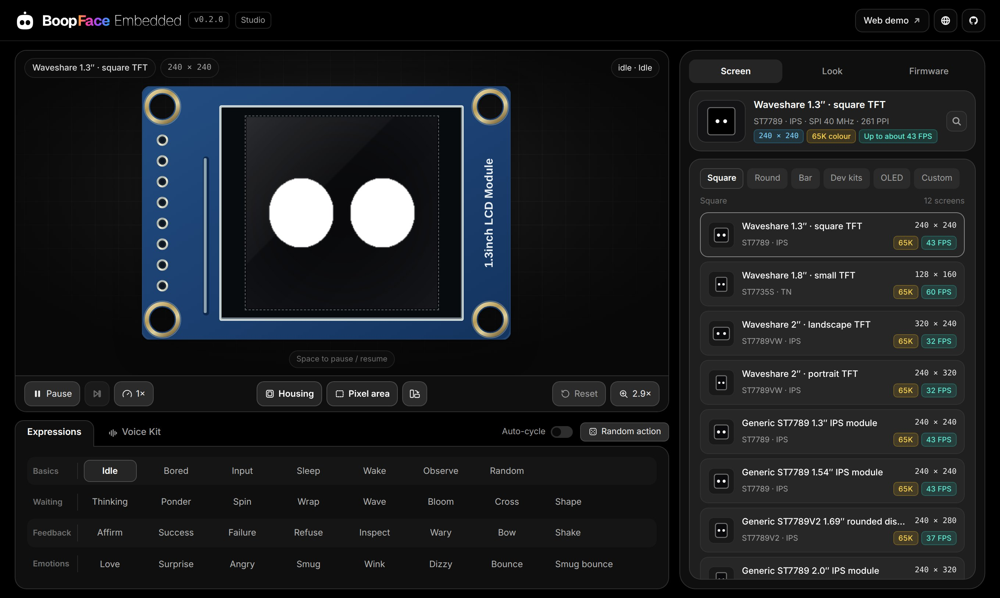

# BoopFace

<p align="center">
  
</p>

**官方网站：[boopface.com](https://boopface.com/)** · **在线演示：[BoopFace Studio](https://boopface.com/demo/?lang=zh-CN)**

[English](https://github.com/CX-ArtLab/boopface/blob/main/README.md) | [简体中文](https://github.com/CX-ArtLab/boopface/blob/main/docs/README.zh-CN.md) | [Español](https://github.com/CX-ArtLab/boopface/blob/main/docs/README.es.md) | [Русский](https://github.com/CX-ArtLab/boopface/blob/main/docs/README.ru.md) | [Français](https://github.com/CX-ArtLab/boopface/blob/main/docs/README.fr.md) | [Português](https://github.com/CX-ArtLab/boopface/blob/main/docs/README.pt.md) | [Deutsch](https://github.com/CX-ArtLab/boopface/blob/main/docs/README.de.md) | [日本語](https://github.com/CX-ArtLab/boopface/blob/main/docs/README.ja.md) | [한국어](https://github.com/CX-ArtLab/boopface/blob/main/docs/README.ko.md) | [繁體中文](https://github.com/CX-ArtLab/boopface/blob/main/docs/README.zh-TW.md)

 [](../LICENSE) [](https://github.com/CX-ArtLab/boopface/actions/workflows/validate.yml) [](https://ko-fi.com/P0E625WIOI)

    

BoopFace 是一个轻量、富表现力的机器人头像组件，适用于 AI 机器人、智能体与交互式应用。思考、等待、完成、出错，智能体的每个状态都能用一个表情说出来。

适合作为 AI 助手和智能体的形象与状态反馈：类似 ChatGPT、Claude、Gemini 的对话助手，类似 Codex、Claude Code、Cursor 的编程智能体，以及各种个人智能体。也可用于桌面伙伴、虚拟宠物、数字吉祥物和聊天机器人头像。

原生 Web Component，SVG + 原生 JavaScript，运行时零依赖，MIT 开源。可以平面显示，也可以切换成会真正转动的立体头像；另有 188 款皮肤随时换上。

https://github.com/user-attachments/assets/533940e6-38e8-45e3-a276-606e1e7bba51

<p align="center">
  <a href="#快速开始">快速开始</a> · <a href="#表情">表情</a> · <a href="#设置">设置</a> · <a href="#立体头像与眼睛">立体头像与眼睛</a> · <a href="#皮肤">皮肤</a> · <a href="#接入-ai">接入 AI</a> · <a href="#语音对话">语音对话</a> · <a href="#react-和-vue">React 和 Vue</a> · <a href="#boopface-embedded">嵌入式设备版</a>
</p>

<p align="center">
  
</p>

## 在线体验

<h3 align="center">官方网站</h3>

<p align="center">
  <a href="https://boopface.com/"><b>boopface.com</b></a>
</p>

<p align="center">
  
</p>

<h3 align="center">BoopFace Studio 在线演示</h3>

<p align="center">
  <a href="https://boopface.com/demo/?lang=zh-CN"><b>打开 Studio</b></a> · <a href="https://boopface.com/demo/?lang=zh-CN#skins">挑选皮肤</a> · <a href="https://boopface.com/demo/?lang=zh-CN#agent">试试接入 AI</a>
</p>

<p align="center">
  
</p>

<p align="center">
  
</p>

<h3 align="center">BoopFace Embedded 嵌入式设备模拟器</h3>

<p align="center">
  <a href="https://boopface.com/hardware/?lang=zh-CN"><b>打开嵌入式设备模拟器</b></a>（32 种开发板屏幕预设）
</p>

<p align="center">
  
</p>

## 0.9 更新内容

- BoopFace 完成立体进化。[详细](#立体头像与眼睛)
- 15 个新表情、语音对话套件。[详细](#表情)
- 新增摸头反应：在额头上来回晃晃鼠标。[详细](#立体头像与眼睛)
- AI 对话接入更新。[详细](#接入-ai)
- 全新重做在线演示页：[BoopFace Studio](https://boopface.com/demo/?lang=zh-CN)
- 嵌入式设备版 0.2：同步更新新表情。[详细](#boopface-embedded)

完整记录见 [CHANGELOG](../CHANGELOG.md)。

<p align="center">
  
</p>

## BoopFace 特点

- 原生 Web Component，SVG 渲染 + 原生 JavaScript，运行时零依赖，任何框架都能用
- 一个会表达情绪的头像组件，可以对应各种不同反应状态
- 30 多种表情，就像具有生命力
- 能互动：眼睛会盯着鼠标移动，拖、挤、按、拉天线、摸头都有反应
- 平面或立体两种样式，适合不同模式使用，188 款皮肤随时换
- AI 数据流的事件直接驱动表情（AG-UI、OpenAI、Anthropic、Vercel AI SDK），支持语音对话
- 轻量：精简版约 92 KB
- BoopFace Embedded 嵌入式设备版：同一套表情也能跑在开发板屏幕上（ESP32、STM32、树莓派 Pico）

<p align="center">
  
</p>

## 快速开始

```bash
npm install boopface
```

```js
import 'boopface';
```

```html
<boop-face id="avatar" view="3d"></boop-face>
```

不需要初始化代码，头像会自己眨眼、待机。`view="3d"` 是官网上的立体头像；不写就是平面头像（默认值，更轻）。

```js
const avatar = document.querySelector('#avatar');
avatar.play('success');
```

不用 npm：从[最新发布](https://github.com/CX-ArtLab/boopface/releases/latest)下载 `boopface-x.y.z.zip`，解压到网页旁边，用 `<script type="module" src="./boopface/boopface.js"></script>` 引入。

**大小**（gzip 后的传输大小）

| 版本 | 大小 |
| --- | --- |
| 精简版 `import 'boopface/lite'`，不含皮肤 | 约 92 KB |
| 完整版，页面没用皮肤 | 约 104 KB |
| 完整版，用到皮肤 | 约 161 KB（皮肤代码第一次用到时才下载） |

切到立体时再多下载约 19 KB。

<p align="center">
  
</p>

## 表情

```js
avatar.play('success');   // 播放一次
avatar.startWaiting();    // 循环等待，直到 stopWaiting() 或播放其他表情
avatar.reset();           // 回到待机
```

| 动作 | 样子 | 适合 |
| --- | --- | --- |
| `idle` | 眨眼、四处看看 | 默认 |
| `bored` | 慢慢往两边张望 | 一段时间没动静 |
| `waiting-spin` | 双眼左右绕圈 | 等待回复（默认） |
| `waiting-wrap` | 双眼从一侧转出、另一侧回来 | 等待回复 |
| `waiting-wave` | 双眼轮流上下起伏 | 等待回复 |
| `waiting-bloom` | 两个交叉椭圆像花一样转动 | 等待回复，适合语音对话 |
| `waiting-cross` | 交叉椭圆停在 × 上，每次转四分之一圈 | 等待回复，适合语音对话 |
| `shape-wait` | 双眼合成一个形状，圆和方之间变换 | 等待回复 |
| `input` | 双眼变成闪烁的光标 | 用户正在输入 |
| `listening` | 双眼合成一个圆，随声音起伏 | 语音：用户在说话 |
| `speaking` | 双眼跟着回答伸缩 | 语音：AI 在回答 |
| `affirm` | 点头 | 收到、确认 |
| `success` | 开心的笑眼 | 任务完成 |
| `failure` | 低头、眼睛下垂 | 失败 |
| `wary` | 侧头上下打量 | 需要用户确认 |
| `inspect` | 眯眼上下扫视 | 检查、审核 |
| `observe` | 凑近看一圈 | 仔细查看 |
| `think` | 抬眼往上看 | 想一想 |
| `ponder` | 低头左右看再抬头 | 认真考虑 |
| `bow` | 深深点一下头 | 道谢、问候 |
| `angry` | 压低眼睛瞪着 | 内容被拦截 |
| `refuse` | 摇头 | 做不到 |
| `shake` | 眼睛转开，头跟着转开 | 不认同 |
| `surprise` | 睁大眼睛 | 意外 |
| `love` | 双眼合成跳动的爱心 | 感谢、喜欢 |
| `wink` | 歪头眨一只眼 | 打招呼、开玩笑 |
| `smug` | 眯眼抬头左右看 | 得意 |
| `bounce` | 像皮球一样弹跳 | 庆祝 |
| `smug-bounce` | 笑着弹两下 | 小得意 |
| `dizzy` | 双眼反向绕圈 | 晕了 |
| `random` | 双眼像老虎机一样滚动 | 随机抽取 |
| `sleep` / `wake` | 闭眼睡觉 / 睁眼醒来 | 长时间无操作 / 重新有动静 |

等待样式：`startWaiting({ variant: 'spin' | 'wrap' | 'wave' | 'bloom' | 'cross' })`。0.5 版的旧动作名在 1.0 前仍可用，见[升级对照表](../CHANGELOG.md#upgrading-from-05x)。

一个典型的请求流程：

```js
avatar.startWaiting();
try {
  const result = await runAgentRequest();
  await avatar.play(result.ok ? 'success' : 'failure');
} catch {
  await avatar.play('failure');
}
```

<p align="center">
  
</p>

## 设置

```html
<boop-face size="160" view="3d" color="#08090b" eye-color="#2bd67b" auto-sleep="30000"></boop-face>
```

| 属性 | 用途 | 运行时方法 |
| --- | --- | --- |
| `size` | 像素尺寸 | |
| `view` | `2d`（默认）或 `3d` | `setView()` |
| `color` | 头像主色 | |
| `eye-color` | 眼睛颜色；`transparent` 透出背景 | `setEyeColor()` |
| `eye-style` | 默认圆角；`sharp` 为直角切口 | |
| `skin` | 皮肤编号，如 `301` | `setSkin()` |
| `auto-sleep` | 空闲多久后睡觉（毫秒），`0` 关闭 | |
| `wake-on` | 唤醒方式：`activity`、`interaction`、`manual` | |
| `motion` | 动效：`auto`、`reduce`、`full` | |
| `idle-gaze` | `false`：闲时不四处张望 | `setIdleGaze()` |
| `petting` | `false`：关闭抚摸 | `setPetting()` |
| `press-squeeze` | `false`：关闭按住挤压 | `setPressSqueeze()` |
| `antenna` | `false`：隐藏天线 | |
| `antenna-drag` | `false`：天线不能拖动 | `setAntennaDrag()` |

其他方法：`setPointerFollow(false)` 不跟随鼠标，`setHeadRoundness(75)` 调头部圆角。

<p align="center">
  
</p>

## 立体头像与眼睛

- **立体**：`view="3d"` 让头像有厚度和弧面，真正转向鼠标，转完轻轻一弹。所有表情、皮肤、颜色照常可用。立体代码第一次切到 3D 时才下载。
- **表情带着头动**：头会跟着眼睛转、点头、跳起来。`motion="reduce"` 时保持不动。
- **圆角眼睛**：眯眼、眨眼这类细缝两头是半圆；`eye-style="sharp"` 恢复直角。
- **眼睛颜色**：`eye-color` 可用于纯色头像和 131 款皮肤；另外 57 款皮肤的眼睛自带质感，保持原样（`SKINS[编号].eyeColor` 可查）。`transparent` 所有皮肤都能用。
- **互动**：眼睛跟随鼠标；拖拽头部会果冻式变形；按住中心会挤压；天线可以拖着弹；在额头上来回摸几下，头像会闭眼蹭过来。

<p align="center">
  
</p>

## 皮肤

188 款皮肤，17 个系列，光线跟随鼠标，全部纯 SVG。编号永久不变：前面是系列号，后两位是序号（305 = 第 3 系列第 5 款）。

```html
<boop-face skin="301"></boop-face>
```

```js
avatar.setSkin(102);
avatar.setSkin(null); // 回到纯色
```


| 系列 | 编号 | 系列 | 编号 | 系列 | 编号 |
| --- | --- | --- | --- | --- | --- |
| 彩色玻璃 | 101–106 | 淡彩玻璃 | 201–206 | 软糖 | 301–312 |
| 糖果玻璃 | 401–406 | 亚克力 | 501–512 | 果冻 | 601–612 |
| 渐变 | 701–712 | 磨砂玻璃 | 801–806 | 磨砂金属 | 901–930 |
| 宝石与陶瓷 | 1001–1012 | 木 | 1101–1106 | 球类 | 1201–1210 |
| 透明与流光 | 1301–1305 | 织物与皮革 | 1401–1412 | 甜点与水果 | 1501–1512 |
| 自然 | 1601–1612 | 图案与科技 | 1701–1717 |  |  |

在 [Studio 皮肤页](https://boopface.com/demo/?lang=zh-CN#skins)查看全部。`await loadSkins()` 可提前加载；`SKINS`、`SKIN_SERIES`、`SKIN_NAMES` 提供名称、系列和编号。

<p align="center">
  
</p>

## 接入 AI

把 AI SDK 给你的数据流交给 `connectAgent()`，头像会自动显示思考、调用工具、回复、完成和出错。

```js
import { connectAgent } from 'boopface';

const agent = connectAgent(avatar);
for await (const event of agent.track(stream)) {
  // 照常显示回复
}
```

支持 AG-UI、OpenAI（Responses、Realtime、Chat Completions）、Anthropic Messages、Vercel AI SDK 和 `useChat` 状态。也可以逐条 `agent.handle(event)`，或直接 `agent.handle('thinking')`。

| 状态 | 默认表情 | 状态 | 默认表情 |
| --- | --- | --- | --- |
| `thinking` | `waiting-spin` | `done` | `success` |
| `tool` | `waiting-wave` | `error` | `failure` |
| `replying` | `idle` | `refused` | `refuse` |
| `approval` | `wary` | `cancelled` | `idle` |
| `listening` | `listening` | `speaking` | `speaking` |
| `typing` | `input` | `idle` | `idle` |

换表情：

```js
connectAgent(avatar, { actions: { replying: 'input', tool: 'inspect' } });
```

可以在 [Studio](https://boopface.com/demo/?lang=zh-CN#agent) 里和接入了 AI 的头像聊天，查看各种格式的接法。

<p align="center">
  
</p>

## 语音对话

语音助手每一轮都是聆听、思考、说话三步，BoopFace 准备了一组衔接自然的表情：

```js
avatar.startListening();                   // 用户在说话
avatar.startWaiting({ variant: 'bloom' }); // AI 在思考
avatar.startSpeaking();                    // AI 在回答
avatar.setVoiceLevel(0.6);                 // 可选：音量 0–1
```

用 `connectAgent()` 时会自动切换（已支持 OpenAI Realtime、ElevenLabs 等）。`connectAudio()` 接上麦克风和回答音频后，眼睛会跟着真实音量动：

```js
const agent = connectAgent(avatar);
events.onmessage = ({ data }) => agent.handle(JSON.parse(data));
agent.connectAudio({ input: microphone, output: replyAudio });
```

<p align="center">
  
</p>

## React 和 Vue

标准 Web Component，任何框架都能直接用。

```jsx
// React 19（Next.js 里加 'use client'）
import { useEffect, useRef } from 'react';
import { connectAgent } from 'boopface';

export function Avatar({ onReady }) {
  const ref = useRef(null);
  useEffect(() => { onReady(connectAgent(ref.current)); }, []);
  return <boop-face ref={ref} size="140" />;
}
```

Vue 3 需要在 `vite.config.js` 里声明自定义元素：

```js
vue({ template: { compilerOptions: { isCustomElement: tag => tag === 'boop-face' } } })
```

直接打开就能跑的示例：[`react.html`](../examples/react.html)、[`vue.html`](../examples/vue.html)、[`basic.html`](../examples/basic.html)。组件会发出 `face-state`（画面状态）和 `action-state`（动作开始与结束）事件，无障碍播报示例见 [`accessibility.html`](../examples/accessibility.html)。内置 TypeScript 类型。

<a id="boopface-embedded"></a>

<p align="center">
  
</p>

## BoopFace Embedded 嵌入式设备版

<p align="center">
  
</p>

同样的眼睛表情，跑在机器人和开发板的屏幕上。小巧的 C++11 引擎，33 个表情，固件示例覆盖 28 种 ESP32、ESP32-S3、STM32、树莓派 Pico 开发板与屏幕组合（圆形/方形 TFT、长条屏、AMOLED、单色 OLED）。



1. **预览**：[在线模拟器](https://boopface.com/hardware/?lang=zh-CN)运行同一套引擎，模拟 32 种屏幕，没有板子也能看效果。
2. **导出**：调好布局、颜色和帧率，点「导出设置」，把 `eyes_settings.h` 放到示例固件的 `main.cpp` 旁边编译。[操作步骤](../embedded/README.zh-CN.md#在模拟器里调好直接用到板子上)
3. **安装**：Arduino IDE 导入[发布页](https://github.com/CX-ArtLab/boopface/releases/tag/eyes-v0.2.0)的 `BoopFace-Embedded-0.2.0.zip`；PlatformIO 用 `lib_deps = cxlab/BoopFace@^0.2.0`。

```cpp
#include <BoopFace.h>
boopface::Eyes eyes;
uint8_t pixels[4800]; // 240 x 160，1 位像素

boopface::EyesConfig config;

void setup() { eyes.begin(config, pixels, sizeof pixels, millis()); }
void loop()  { if (eyes.update(millis())) { /* 把 eyes.data() 发到屏幕 */ } }
// eyes.play("success", millis());
```

实验版：全部配置在 CI 编译通过，尚未在真实硬件上逐一验证，欢迎提交[实机验证报告](https://github.com/CX-ArtLab/boopface/issues/new?template=hardware_report.yml)。完整说明见[嵌入式设备版文档](../embedded/README.zh-CN.md)。

<p align="center">
  
</p>

## 其他

- **从 Agent Robot Avatar 升级**：0.8 起改名，用法不变。`npm uninstall agent-robot-avatar && npm install boopface` 即可，旧标签 `<agent-robot-avatar>` 在 1.0 前仍可用。
- **兼容性**：支持 ES Modules、Custom Elements 和 Web Animations 的现代浏览器；自动测试覆盖 Chromium、Firefox、WebKit。
- **版本**：**网页版 v0.9.0**，嵌入式设备版 v0.2.0（实验版）。1.0 前 API 会谨慎演进。
- **作品展示**：[社区作品](../SHOWCASE.md)，[提交你的作品](https://github.com/CX-ArtLab/BoopFace/issues/new?template=showcase-submission.yml)。
- **参与贡献**：欢迎 Issue 和 PR，请先读 [`CONTRIBUTING.md`](../CONTRIBUTING.md)。

<p align="center">
  
</p>

## 许可与角色

代码采用 [MIT License](../LICENSE)，可以在应用中使用、修改和分发。BoopFace 角色外观、名称与视觉标识是 CX ArtLab 的原创设计，MIT 许可不转移其所有权，也不授权将其作为他方原创角色或品牌展示。

BoopFace 是独立开源项目，与任何 AI 平台或品牌无关联、无官方背书；文中提及的产品名仅用于说明使用场景。

<p align="center">
  
</p>

## 请我喝杯咖啡

| Ko-fi | 支付宝 | 微信支付 |
| --- | --- | --- |
| <a href='https://ko-fi.com/P0E625WIOI' target='_blank'></a> |  |  |
