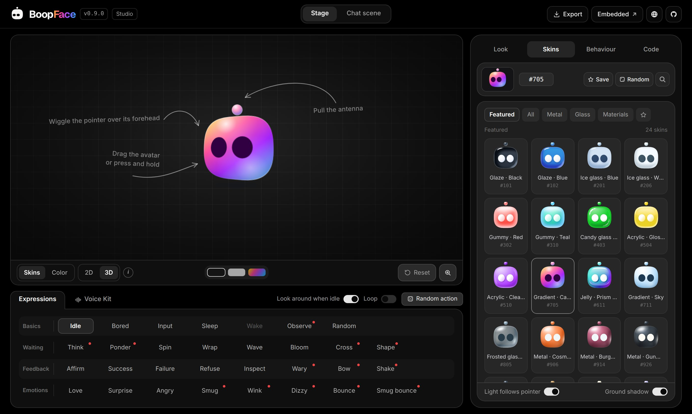

# BoopFace

<p align="center">
  
</p>

**官方網站：[boopface.com](https://boopface.com/)** · **線上演示：[BoopFace Studio](https://boopface.com/demo/?lang=zh-TW)**

[English](https://github.com/CX-ArtLab/boopface/blob/main/README.md) | [簡體中文](https://github.com/CX-ArtLab/boopface/blob/main/docs/README.zh-CN.md) | [Español](https://github.com/CX-ArtLab/boopface/blob/main/docs/README.es.md) | [Русский](https://github.com/CX-ArtLab/boopface/blob/main/docs/README.ru.md) | [Français](https://github.com/CX-ArtLab/boopface/blob/main/docs/README.fr.md) | [Português](https://github.com/CX-ArtLab/boopface/blob/main/docs/README.pt.md) | [Deutsch](https://github.com/CX-ArtLab/boopface/blob/main/docs/README.de.md) | [日本語](https://github.com/CX-ArtLab/boopface/blob/main/docs/README.ja.md) | [한국어](https://github.com/CX-ArtLab/boopface/blob/main/docs/README.ko.md) | [繁體中文](https://github.com/CX-ArtLab/boopface/blob/main/docs/README.zh-TW.md)

 [](../LICENSE) [](https://github.com/CX-ArtLab/boopface/actions/workflows/validate.yml) [](https://ko-fi.com/P0E625WIOI)

    

BoopFace 是一個輕量、富表現力的機器人頭像元件，適用於 AI 機器人、智慧體與互動式應用。思考、等待、完成、出錯，智慧體的每個狀態都能用一個表情說出來。

適合作為 AI 助手和智慧體的形象與狀態反饋：類似 ChatGPT、Claude、Gemini 的對話助手，類似 Codex、Claude Code、Cursor 的程式設計智慧體，以及各種個人智慧體。也可用於桌面夥伴、虛擬寵物、數字吉祥物和聊天機器人頭像。

原生 Web Component，SVG + 原生 JavaScript，執行時零依賴，MIT 開源。可以平面顯示，也可以切換成會真正轉動的立體頭像；另有 188 款皮膚隨時換上。

https://github.com/user-attachments/assets/533940e6-38e8-45e3-a276-606e1e7bba51

<p align="center">
  <a href="#快速開始">快速開始</a> · <a href="#表情">表情</a> · <a href="#設定">設定</a> · <a href="#立體頭像與眼睛">立體頭像與眼睛</a> · <a href="#皮膚">皮膚</a> · <a href="#接入-ai">接入 AI</a> · <a href="#語音對話">語音對話</a> · <a href="#react-和-vue">React 和 Vue</a> · <a href="#boopface-embedded">嵌入式裝置版</a>
</p>

<p align="center">
  
</p>

## 線上體驗

<h3 align="center">官方網站</h3>

<p align="center">
  <a href="https://boopface.com/"><b>boopface.com</b></a>
</p>

<p align="center">
  
</p>

<h3 align="center">BoopFace Studio 線上演示</h3>

<p align="center">
  <a href="https://boopface.com/demo/?lang=zh-TW"><b>開啟 Studio</b></a> · <a href="https://boopface.com/demo/?lang=zh-TW#skins">挑選皮膚</a> · <a href="https://boopface.com/demo/?lang=zh-TW#agent">試試接入 AI</a>
</p>

<p align="center">
  
</p>

<p align="center">
  
</p>

<h3 align="center">BoopFace Embedded 嵌入式裝置模擬器</h3>

<p align="center">
  <a href="https://boopface.com/hardware/?lang=zh-TW"><b>開啟嵌入式裝置模擬器</b></a>（32 種開發板螢幕預設）
</p>

<p align="center">
  
</p>

## 0.9 更新內容

- BoopFace 完成立體進化。[詳細](#立體頭像與眼睛)
- 15 個新表情、語音對話套件。[詳細](#表情)
- 新增摸頭反應：在額頭上來回晃晃滑鼠。[詳細](#立體頭像與眼睛)
- AI 對話接入更新。[詳細](#接入-ai)
- 全新重做線上演示頁：[BoopFace Studio](https://boopface.com/demo/?lang=zh-TW)
- 嵌入式裝置版 0.2：同步更新新表情。[詳細](#boopface-embedded)

完整記錄見 [CHANGELOG](../CHANGELOG.md)。

<p align="center">
  
</p>

## BoopFace 特點

- 原生 Web Component，SVG 渲染 + 原生 JavaScript，執行時零依賴，任何框架都能用
- 一個會表達情緒的頭像元件，可以對應各種不同反應狀態
- 30 多種表情，就像具有生命力
- 能互動：眼睛會盯著滑鼠移動，拖、擠、按、拉天線、摸頭都有反應
- 平面或立體兩種樣式，適合不同模式使用，188 款皮膚隨時換
- AI 資料流的事件直接驅動表情（AG-UI、OpenAI、Anthropic、Vercel AI SDK），支援語音對話
- 輕量：精簡版約 92 KB
- BoopFace Embedded 嵌入式裝置版：同一套表情也能跑在開發板螢幕上（ESP32、STM32、樹莓派 Pico）

<p align="center">
  
</p>

## 快速開始

```bash
npm install boopface
```

```js
import 'boopface';
```

```html
<boop-face id="avatar" view="3d"></boop-face>
```

不需要初始化程式碼，頭像會自己眨眼、待機。`view="3d"` 是官網上的立體頭像；不寫就是平面頭像（預設值，更輕）。

```js
const avatar = document.querySelector('#avatar');
avatar.play('success');
```

不用 npm：從[最新發布](https://github.com/CX-ArtLab/boopface/releases/latest)下載 `boopface-x.y.z.zip`，解壓到網頁旁邊，用 `<script type="module" src="./boopface/boopface.js"></script>` 引入。

**大小**（gzip 後的傳輸大小）

| 版本 | 大小 |
| --- | --- |
| 精簡版 `import 'boopface/lite'`，不含皮膚 | 約 92 KB |
| 完整版，頁面沒用皮膚 | 約 104 KB |
| 完整版，用到皮膚 | 約 161 KB（皮膚程式碼第一次用到時才下載） |

切到立體時再多下載約 19 KB。

<p align="center">
  
</p>

## 表情

```js
avatar.play('success');   // 播放一次
avatar.startWaiting();    // 循环等待，直到 stopWaiting() 或播放其他表情
avatar.reset();           // 回到待机
```

| 動作 | 樣子 | 適合 |
| --- | --- | --- |
| `idle` | 眨眼、四處看看 | 預設 |
| `bored` | 慢慢往兩邊張望 | 一段時間沒動靜 |
| `waiting-spin` | 雙眼左右繞圈 | 等待回覆（預設） |
| `waiting-wrap` | 雙眼從一側轉出、另一側回來 | 等待回覆 |
| `waiting-wave` | 雙眼輪流上下起伏 | 等待回覆 |
| `waiting-bloom` | 兩個交叉橢圓像花一樣轉動 | 等待回覆，適合語音對話 |
| `waiting-cross` | 交叉橢圓停在 × 上，每次轉四分之一圈 | 等待回覆，適合語音對話 |
| `shape-wait` | 雙眼合成一個形狀，圓和方之間變換 | 等待回覆 |
| `input` | 雙眼變成閃爍的游標 | 使用者正在輸入 |
| `listening` | 雙眼合成一個圓，隨聲音起伏 | 語音：使用者在說話 |
| `speaking` | 雙眼跟著回答伸縮 | 語音：AI 在回答 |
| `affirm` | 點頭 | 收到、確認 |
| `success` | 開心的笑眼 | 任務完成 |
| `failure` | 低頭、眼睛下垂 | 失敗 |
| `wary` | 側頭上下打量 | 需要使用者確認 |
| `inspect` | 眯眼上下掃視 | 檢查、稽覈 |
| `observe` | 湊近看一圈 | 仔細檢視 |
| `think` | 抬眼往上看 | 想一想 |
| `ponder` | 低頭左右看再抬頭 | 認真考慮 |
| `bow` | 深深點一下頭 | 道謝、問候 |
| `angry` | 壓低眼睛瞪著 | 內容被攔截 |
| `refuse` | 搖頭 | 做不到 |
| `shake` | 眼睛轉開，頭跟著轉開 | 不認同 |
| `surprise` | 睜大眼睛 | 意外 |
| `love` | 雙眼合成跳動的愛心 | 感謝、喜歡 |
| `wink` | 歪頭眨一隻眼 | 打招呼、開玩笑 |
| `smug` | 眯眼抬頭左右看 | 得意 |
| `bounce` | 像皮球一樣彈跳 | 慶祝 |
| `smug-bounce` | 笑著彈兩下 | 小得意 |
| `dizzy` | 雙眼反向繞圈 | 暈了 |
| `random` | 雙眼像老虎機一樣滾動 | 隨機抽取 |
| `sleep` / `wake` | 閉眼睡覺 / 睜眼醒來 | 長時間無操作 / 重新有動靜 |

等待樣式：`startWaiting({ variant: 'spin' | 'wrap' | 'wave' | 'bloom' | 'cross' })`。0.5 版的舊動作名在 1.0 前仍可用，見[升級對照表](../CHANGELOG.md#upgrading-from-05x)。

一個典型的請求流程：

```js
avatar.startWaiting();
try {
  const result = await runAgentRequest();
  await avatar.play(result.ok ? 'success' : 'failure');
} catch {
  await avatar.play('failure');
}
```

<p align="center">
  
</p>

## 設定

```html
<boop-face size="160" view="3d" color="#08090b" eye-color="#2bd67b" auto-sleep="30000"></boop-face>
```

| 屬性 | 用途 | 執行時方法 |
| --- | --- | --- |
| `size` | 畫素尺寸 | |
| `view` | `2d`（預設）或 `3d` | `setView()` |
| `color` | 頭像主色 | |
| `eye-color` | 眼睛顏色；`transparent` 透出背景 | `setEyeColor()` |
| `eye-style` | 預設圓角；`sharp` 為直角切口 | |
| `skin` | 皮膚編號，如 `301` | `setSkin()` |
| `auto-sleep` | 空閒多久後睡覺（毫秒），`0` 關閉 | |
| `wake-on` | 喚醒方式：`activity`、`interaction`、`manual` | |
| `motion` | 動效：`auto`、`reduce`、`full` | |
| `idle-gaze` | `false`：閒時不四處張望 | `setIdleGaze()` |
| `petting` | `false`：關閉撫摸 | `setPetting()` |
| `press-squeeze` | `false`：關閉按住擠壓 | `setPressSqueeze()` |
| `antenna` | `false`：隱藏天線 | |
| `antenna-drag` | `false`：天線不能拖動 | `setAntennaDrag()` |

其他方法：`setPointerFollow(false)` 不跟隨滑鼠，`setHeadRoundness(75)` 調頭部圓角。

<p align="center">
  
</p>

## 立體頭像與眼睛

- **立體**：`view="3d"` 讓頭像有厚度和弧面，真正轉向滑鼠，轉完輕輕一彈。所有表情、皮膚、顏色照常可用。立體程式碼第一次切到 3D 時才下載。
- **表情帶著頭動**：頭會跟著眼睛轉、點頭、跳起來。`motion="reduce"` 時保持不動。
- **圓角眼睛**：眯眼、眨眼這類細縫兩頭是半圓；`eye-style="sharp"` 恢復直角。
- **眼睛顏色**：`eye-color` 可用於純色頭像和 131 款皮膚；另外 57 款皮膚的眼睛自帶質感，保持原樣（`SKINS[编号].eyeColor` 可查）。`transparent` 所有皮膚都能用。
- **互動**：眼睛跟隨滑鼠；拖拽頭部會果凍式變形；按住中心會擠壓；天線可以拖著彈；在額頭上來回摸幾下，頭像會閉眼蹭過來。

<p align="center">
  
</p>

## 皮膚

188 款皮膚，17 個系列，光線跟隨滑鼠，全部純 SVG。編號永久不變：前面是系列號，後兩位是序號（305 = 第 3 系列第 5 款）。

```html
<boop-face skin="301"></boop-face>
```

```js
avatar.setSkin(102);
avatar.setSkin(null); // 回到纯色
```



| 系列 | 編號 | 系列 | 編號 | 系列 | 編號 |
| --- | --- | --- | --- | --- | --- |
| 彩色玻璃 | 101–106 | 淡彩玻璃 | 201–206 | 軟糖 | 301–312 |
| 糖果玻璃 | 401–406 | 亞克力 | 501–512 | 果凍 | 601–612 |
| 漸變 | 701–712 | 磨砂玻璃 | 801–806 | 磨砂金屬 | 901–930 |
| 寶石與陶瓷 | 1001–1012 | 木 | 1101–1106 | 球類 | 1201–1210 |
| 透明與流光 | 1301–1305 | 織物與皮革 | 1401–1412 | 甜點與水果 | 1501–1512 |
| 自然 | 1601–1612 | 圖案與科技 | 1701–1717 |  |  |

在 [Studio 皮膚頁](https://boopface.com/demo/?lang=zh-TW#skins)檢視全部。`await loadSkins()` 可提前載入；`SKINS`、`SKIN_SERIES`、`SKIN_NAMES` 提供名稱、系列和編號。

<p align="center">
  
</p>

## 接入 AI

把 AI SDK 給你的資料流交給 `connectAgent()`，頭像會自動顯示思考、呼叫工具、回覆、完成和出錯。

```js
import { connectAgent } from 'boopface';

const agent = connectAgent(avatar);
for await (const event of agent.track(stream)) {
  // 照常显示回复
}
```

支援 AG-UI、OpenAI（Responses、Realtime、Chat Completions）、Anthropic Messages、Vercel AI SDK 和 `useChat` 狀態。也可以逐條 `agent.handle(event)`，或直接 `agent.handle('thinking')`。

| 狀態 | 預設表情 | 狀態 | 預設表情 |
| --- | --- | --- | --- |
| `thinking` | `waiting-spin` | `done` | `success` |
| `tool` | `waiting-wave` | `error` | `failure` |
| `replying` | `idle` | `refused` | `refuse` |
| `approval` | `wary` | `cancelled` | `idle` |
| `listening` | `listening` | `speaking` | `speaking` |
| `typing` | `input` | `idle` | `idle` |

換表情：

```js
connectAgent(avatar, { actions: { replying: 'input', tool: 'inspect' } });
```

可以在 [Studio](https://boopface.com/demo/?lang=zh-TW#agent) 裡和接入了 AI 的頭像聊天，檢視各種格式的接法。

<p align="center">
  
</p>

## 語音對話

語音助手每一輪都是聆聽、思考、說話三步，BoopFace 準備了一組銜接自然的表情：

```js
avatar.startListening();                   // 用户在说话
avatar.startWaiting({ variant: 'bloom' }); // AI 在思考
avatar.startSpeaking();                    // AI 在回答
avatar.setVoiceLevel(0.6);                 // 可选：音量 0–1
```

用 `connectAgent()` 時會自動切換（已支援 OpenAI Realtime、ElevenLabs 等）。`connectAudio()` 接上麥克風和回答音訊後，眼睛會跟著真實音量動：

```js
const agent = connectAgent(avatar);
events.onmessage = ({ data }) => agent.handle(JSON.parse(data));
agent.connectAudio({ input: microphone, output: replyAudio });
```

<p align="center">
  
</p>

## React 和 Vue

標準 Web Component，任何框架都能直接用。

```jsx
// React 19（Next.js 里加 'use client'）
import { useEffect, useRef } from 'react';
import { connectAgent } from 'boopface';

export function Avatar({ onReady }) {
  const ref = useRef(null);
  useEffect(() => { onReady(connectAgent(ref.current)); }, []);
  return <boop-face ref={ref} size="140" />;
}
```

Vue 3 需要在 `vite.config.js` 裡宣告自定義元素：

```js
vue({ template: { compilerOptions: { isCustomElement: tag => tag === 'boop-face' } } })
```

直接開啟就能跑的示例：[`react.html`](../examples/react.html)、[`vue.html`](../examples/vue.html)、[`basic.html`](../examples/basic.html)。元件會發出 `face-state`（畫面狀態）和 `action-state`（動作開始與結束）事件，無障礙播報示例見 [`accessibility.html`](../examples/accessibility.html)。內建 TypeScript 型別。

<a id="boopface-embedded"></a>

<p align="center">
  
</p>

## BoopFace Embedded 嵌入式裝置版

<p align="center">
  
</p>

同樣的眼睛表情，跑在機器人和開發板的螢幕上。小巧的 C++11 引擎，33 個表情，韌體示例覆蓋 28 種 ESP32、ESP32-S3、STM32、樹莓派 Pico 開發板與螢幕組合（圓形/方形 TFT、長條屏、AMOLED、單色 OLED）。


1. **預覽**：[線上模擬器](https://boopface.com/hardware/?lang=zh-TW)執行同一套引擎，模擬 32 種螢幕，沒有板子也能看效果。
2. **匯出**：調好佈局、顏色和幀率，點「匯出設定」，把 `eyes_settings.h` 放到示例韌體的 `main.cpp` 旁邊編譯。[操作步驟](../embedded/README.zh-TW.md#在模擬器裡調好直接用到板子上)
3. **安裝**：Arduino IDE 匯入[釋出頁](https://github.com/CX-ArtLab/boopface/releases/tag/eyes-v0.2.0)的 `BoopFace-Embedded-0.2.0.zip`；PlatformIO 用 `lib_deps = cxlab/BoopFace@^0.2.0`。

```cpp
#include <BoopFace.h>
boopface::Eyes eyes;
uint8_t pixels[4800]; // 240 x 160，1 位像素

boopface::EyesConfig config;

void setup() { eyes.begin(config, pixels, sizeof pixels, millis()); }
void loop()  { if (eyes.update(millis())) { /* 把 eyes.data() 发到屏幕 */ } }
// eyes.play("success", millis());
```

實驗版：全部配置在 CI 編譯通過，尚未在真實硬體上逐一驗證，歡迎提交[實機驗證報告](https://github.com/CX-ArtLab/boopface/issues/new?template=hardware_report.yml)。完整說明見[嵌入式裝置版文件](../embedded/README.zh-TW.md)。

<p align="center">
  
</p>

## 其他

- **從 Agent Robot Avatar 升級**：0.8 起改名，用法不變。`npm uninstall agent-robot-avatar && npm install boopface` 即可，舊標籤 `<agent-robot-avatar>` 在 1.0 前仍可用。
- **相容性**：支援 ES Modules、Custom Elements 和 Web Animations 的現代瀏覽器；自動測試覆蓋 Chromium、Firefox、WebKit。
- **版本**：**網頁版 v0.9.0**，嵌入式裝置版 v0.2.0（實驗版）。1.0 前 API 會謹慎演進。
- **作品展示**：[社羣作品](../SHOWCASE.md)，[提交你的作品](https://github.com/CX-ArtLab/BoopFace/issues/new?template=showcase-submission.yml)。
- **參與貢獻**：歡迎 Issue 和 PR，請先讀 [`CONTRIBUTING.md`](../CONTRIBUTING.md)。

<p align="center">
  
</p>

## 許可與角色

程式碼採用 [MIT License](../LICENSE)，可以在應用中使用、修改和分發。BoopFace 角色外觀、名稱與視覺標識是 CX ArtLab 的原創設計，MIT 許可不轉移其所有權，也不授權將其作為他方原創角色或品牌展示。

BoopFace 是獨立開源專案，與任何 AI 平臺或品牌無關聯、無官方背書；文中提及的產品名僅用於說明使用場景。

<p align="center">
  
</p>

## 請我喝杯咖啡

| Ko-fi | 支付寶 | 微信支付 |
| --- | --- | --- |
| <a href='https://ko-fi.com/P0E625WIOI' target='_blank'></a> |  |  |
